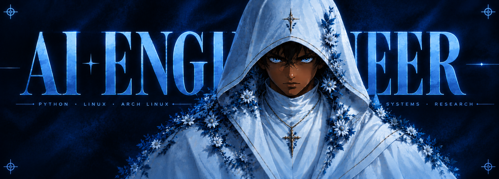

# Biell63

 

<code>AI ENGINEERING</code> &nbsp;·&nbsp; <code>SYSTEMS</code> &nbsp;·&nbsp; <code>RESEARCH</code>

  

**Engineering intelligent systems**

Exploring artificial intelligence, computational methods, and the systems behind modern software.

 

---

<h2 align="center">Research & Engineering</h2>

<table>
<tr>
<td width="50%" valign="top">

### Artificial Intelligence

Exploring intelligent applications, AI systems, and computational approaches to solving problems.

</td>
<td width="50%" valign="top">

### Systems Engineering

Working with Python, Linux environments, shell scripting, and automation.

</td>
</tr>
</table>

---

<h2 align="center">Technologies</h2>

| Domain | Technologies |
|:--|:--|
| Language | Python |
| Operating System | Arch Linux |
| Shell | Bash / Shell |
| Environment | Linux |
| Version Control | Git |

---

<h2 align="center">Selected Projects</h2>

**Research through code. Engineering through experimentation.**

 

Explore my repositories and ongoing work.

  

---

<h2 align="center">Connect</h2>

  

Python · AI Engineering · Linux · Arch Linux

